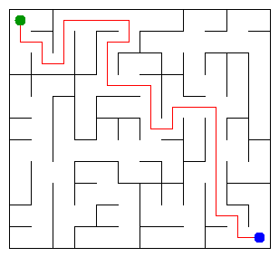

# Assignment 3. Maze Escape

**Student ID:** 241496  
**Name:** Medina Maratova  
**Group:** SE-2519  
**Course:** Design and Analysis of Algorithms  
**Maze size:** 9 x 12 (108 cells)

## Program output

Results obtained using `java -cp out Main`:

```text
Broken: 107
Kept: 88
Last broken wall: 164
MST cost: 35010
Heaviest broken wall: 881
Path length: 35
DFS visited: 53
Dead ends: 31
Zones: 9
Largest zone: 20
Is DAG: 0
Flow stages: 5
Fastest route cost: 5
```

My maze:



## Questions

### Mission 0. Disjoint Set Union

The `find` method returns the root of the set containing an element. The `union` method connects two different sets and returns false if they are already connected.

I used path compression in `find` and union by size in `union`. These optimizations make the operations very efficient.

### Mission 1. Building the maze

The maze has R*C cells. To connect all cells without creating cycles, exactly R*C - 1 walls must be broken because the result is a spanning tree.

A rectangular grid contains R*(C-1) + C*(R-1) internal walls. After breaking R*C - 1 walls, the number of remaining walls is (R-1)*(C-1).

### Mission 2. Minimum Spanning Tree

My minimum spanning tree cost is 35010 using Kruskal. Prim should return the same value, since both algorithms find a minimum spanning tree of the same weighted graph.

Kruskal sorts edges by weight and uses DSU to avoid cycles. Prim grows the tree by selecting the cheapest edge connecting a visited cell to an unvisited cell.

### Mission 3. DFS Escape

There is exactly one path between any two cells because the maze is a tree. A tree is connected and contains no cycles.

I used iterative DFS with an explicit array stack instead of recursion. This avoids call-stack overflow on large mazes.

### Mission 4. Kosaraju

The second pass uses the reversed graph to identify strongly connected components correctly in decreasing finishing-time order.

A directed graph has no cycles exactly when every strongly connected component contains one vertex, assuming there are no self-loops. Therefore, the slides form a DAG when the number of zones equals the number of cells.

### Mission 5. Fastest Route

The zones are numbered in topological order, so every edge between different zones goes from a smaller zone number to a larger one.

This allows the algorithm to process each zone once and update the longest chain and shortest route using dynamic programming. The pass takes O(n + m) time when the graph is represented with adjacency lists.

## AI use

I used ChatGPT to understand the assignment requirements, review Java code, explain DSU, Kruskal, Prim, DFS, Kosaraju, and DAG algorithms, and help identify and correct programming errors.

I also used AI-generated code suggestions while implementing and testing the assignment. I checked the implementation using the provided test program and reviewed the algorithm logic.

## Timing (Mission 7)

Milliseconds, five runs each, using `java -cp out Bench`.

| Maze | Kruskal (average) | Prim (average) |
|---|---:|---:|
| 100 x 100 | 7 ms | 8 ms |
| 300 x 300 | 59 ms | 48 ms |
| 1000 x 1000 | 691 ms | 1239 ms |

The execution time increases as the maze size grows because more cells and walls must be processed. On the largest tested maze, Kruskal was faster than Prim in my measurements. The results also depend on the computer and Java runtime.

## Complexity

Let n be the number of cells and m be the number of walls or slides.

| Algorithm | Time | Space | Assumptions |
|---|---|---|---|
| DSU find and union | O(alpha(n)) amortized | O(n) | Path compression and union by size |
| Kruskal | O(m log m) | O(n + m) | Edges sorted by weight |
| Prim | O(m log m) | O(n + m) | Adjacency lists and priority queue |
| DFS | O(n + m) | O(n + m) | Iterative DFS |
| Kosaraju | O(n + m) | O(n + m) | Two DFS passes |
| Route in the zone graph | O(n + m) | O(n + m) | Topologically ordered zones |

## Testing

I compiled the project using Java 17 and tested it using:

```bash
javac -d out src/*.java
java tools/Check.java
```

Results:

- Mission 0: All checks passed.
- Tiny example: All 13 lines are right.
- Small example: All 13 lines are right.
- DAG example: All 13 lines are right.

I also generated my individual maze using Student ID 241496 and ran the main program successfully.

## Before submission

- [x] Source code implemented for Missions 0–5.
- [x] All provided examples pass.
- [x] Program output recorded.
- [x] Benchmark results recorded.
- [x] Algorithm complexity documented.
- [x] AI use disclosed.
- [ ] Verify personal input files and final maze image are pushed.
- [ ] Verify commit history and submit GitHub link in Moodle.
